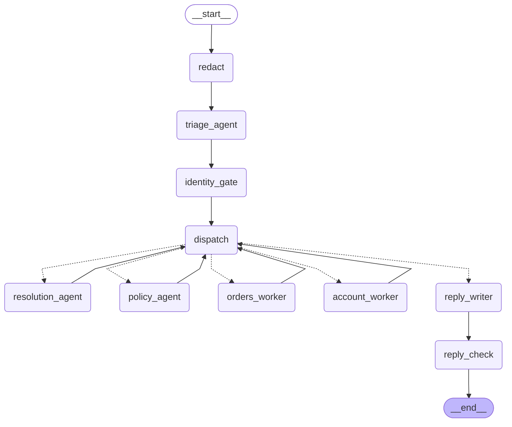

# AgentDesk architecture

AgentDesk runs one explicit LangGraph `StateGraph`. The Supervisor node selects the
first specialist, and every node reads and updates the same Pydantic
`AgentGraphState`. Deterministic tools remain outside model control: protected reads
require verified identity, writes pass through the Python Policy Engine, and the
business effect plus `audit_log` record commit in one SQLite transaction.

## Compiled graph

This Mermaid diagram is exported from
`Supervisor(...).mermaid()`, which calls
`compiled_graph.get_graph().draw_mermaid()`:

Conditional dotted edges are selected from typed graph state:

- Order status: `supervisor → identity → orders → model_reply → finalize`
- Refund: `supervisor → identity → returns_refunds → model_reply → finalize`
- Multi-intent: `supervisor → identity → returns_refunds → account`
  and optionally back to `returns_refunds`
- Policy: `supervisor → policy_knowledge → verifier → finalize`
- Follow-up: `supervisor → memory → returns_refunds → model_reply → finalize`

## Agent team (M7): three agents propose, code decides

`Supervisor.handle_message` runs this compiled LangGraph (`agentdesk/agents/team.py`),
exported with `draw_mermaid()`:

### Who decides what

| Decision | Owner | How |
|---|---|---|
| Which requests a message contains, in order | **triage_agent** (LLM) | Typed plan of intents; cannot name amounts, orders or approvals |
| Which remedy fits, what to offer when a request is denied | **resolution_agent** (LLM, tool loop) | Read-only tools bound to the verified order: `get_order_facts`, `check_option` (policy dry run); max 4 tool calls |
| What to search for, whether the policies answer the question | **policy_agent** (LLM, tool loop) | Writes its own `search_policies` queries; max 3 searches |
| Hide PII before any model call | code: `redact` | Pattern redaction of email, phone, street address |
| Who the customer is | code: `identity_gate` | Order ID + email must match before any order read |
| Whether an action is allowed | code: policy engine | Checked when the agent proposes and again at write time |
| What actually runs | code: `resolution_agent` node | Executes only the option the customer asked for; other options become offers; disallowed offers are dropped |
| Whether a policy answer is shown | code: citation check | Every citation must have been retrieved in this run and exist |
| Whether the reply can be sent | code: `reply_check` | No refund claim unless one was written (negation-aware); no amounts absent from the facts |
| Writes | code: workers | Idempotency key per order item, audit row, one transaction |
| "Today" for the 30-day rule | code: `store_clock()` | Pinned to the synthetic store's date unless `AGENTDESK_NOW` is set |

### Measured cost of adding agents (recorded runs, 8 cases)

| | Model calls | Tokens |
|---|---|---|
| v2: planner only | 16 | 6,480 |
| v3: three agents | 39 | 24,534 |

The resolution agent adds value when a request is denied (it found two allowed
alternatives) and adds cost without value on simple approvals, which suggests a code
fast path for requests the policy engine already allows.

## Free-text planning (M6)

`Supervisor.handle_message` is the free-text entry point:

1. `redact_free_text` replaces emails, phone numbers and street addresses in the message.
2. `PlannerAgent` (the LLM) returns a `PlannerOutput`: an ordered list of intents
   (`order_status`, `refund`, `address_change`, `policy_question`), a refund reason, and an
   optional clarifying question. Unknown fields are rejected, so the plan cannot carry an
   amount or an approval. An invalid plan falls back to a clarifying question.
3. Code verifies the order ID and email before any order data is read.
4. Each intent runs through the compiled graph below. The policy engine decides every
   action; idempotency keys are derived from the order and item, so asking twice writes once.
5. An output check replaces a refund reply that claims an action no tool committed.

## Runtime layers

1. Streamlit or scripted scenarios construct a typed Supervisor request.
2. LangGraph routes the request through specialist nodes and shared Pydantic state.
3. Specialists call typed tools; tools own identity checks, policy checks,
   idempotency, transactions, and audit writes.
4. Model requests go through strict RECORD/REPLAY before the LangChain provider adapter.
5. In RECORD mode, `LangChainModelClient` selects `ChatOpenAI`, `ChatAnthropic`, or
   `ChatBedrockConverse`.
6. Streamlit renders this exported Mermaid graph and appends an active-node style while
   each node runs.

The graph controls orchestration only. It cannot approve money movement or account
changes; the deterministic Policy Engine remains the authorization boundary.
