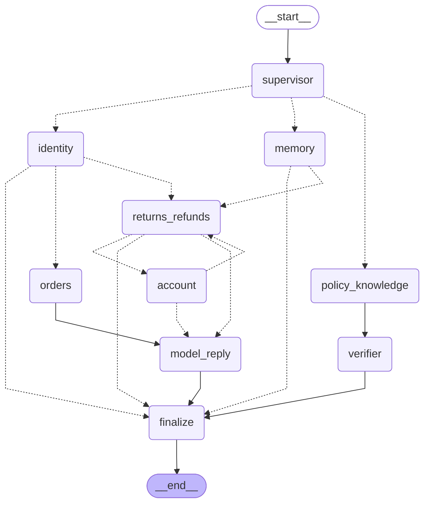

# AgentDesk architecture

AgentDesk runs one explicit LangGraph `StateGraph`. The Supervisor node selects the
first specialist, and every node reads and updates the same Pydantic
`AgentGraphState`. Deterministic tools remain outside model control: protected reads
require verified identity, writes pass through the Python Policy Engine, and the
business effect plus `audit_log` record commit in one SQLite transaction.

## Compiled graph

This Mermaid diagram is exported from
`Supervisor(...).mermaid()`, which calls
`compiled_graph.get_graph().draw_mermaid()`:

Conditional dotted edges are selected from typed graph state:

- Order status: `supervisor → identity → orders → model_reply → finalize`
- Refund: `supervisor → identity → returns_refunds → model_reply → finalize`
- Multi-intent: `supervisor → identity → returns_refunds → account`
  and optionally back to `returns_refunds`
- Policy: `supervisor → policy_knowledge → verifier → finalize`
- Follow-up: `supervisor → memory → returns_refunds → model_reply → finalize`

## Free-text planning (M6)

`Supervisor.handle_message` is the free-text entry point:

1. `redact_free_text` replaces emails, phone numbers and street addresses in the message.
2. `PlannerAgent` (the LLM) returns a `PlannerOutput`: an ordered list of intents
   (`order_status`, `refund`, `address_change`, `policy_question`), a refund reason, and an
   optional clarifying question. Unknown fields are rejected, so the plan cannot carry an
   amount or an approval. An invalid plan falls back to a clarifying question.
3. Code verifies the order ID and email before any order data is read.
4. Each intent runs through the compiled graph below. The policy engine decides every
   action; idempotency keys are derived from the order and item, so asking twice writes once.
5. An output check replaces a refund reply that claims an action no tool committed.

## Runtime layers

1. Streamlit or scripted scenarios construct a typed Supervisor request.
2. LangGraph routes the request through specialist nodes and shared Pydantic state.
3. Specialists call typed tools; tools own identity checks, policy checks,
   idempotency, transactions, and audit writes.
4. Model requests go through strict RECORD/REPLAY before the LangChain provider adapter.
5. In RECORD mode, `LangChainModelClient` selects `ChatOpenAI`, `ChatAnthropic`, or
   `ChatBedrockConverse`.
6. Streamlit renders this exported Mermaid graph and appends an active-node style while
   each node runs.

The graph controls orchestration only. It cannot approve money movement or account
changes; the deterministic Policy Engine remains the authorization boundary.
