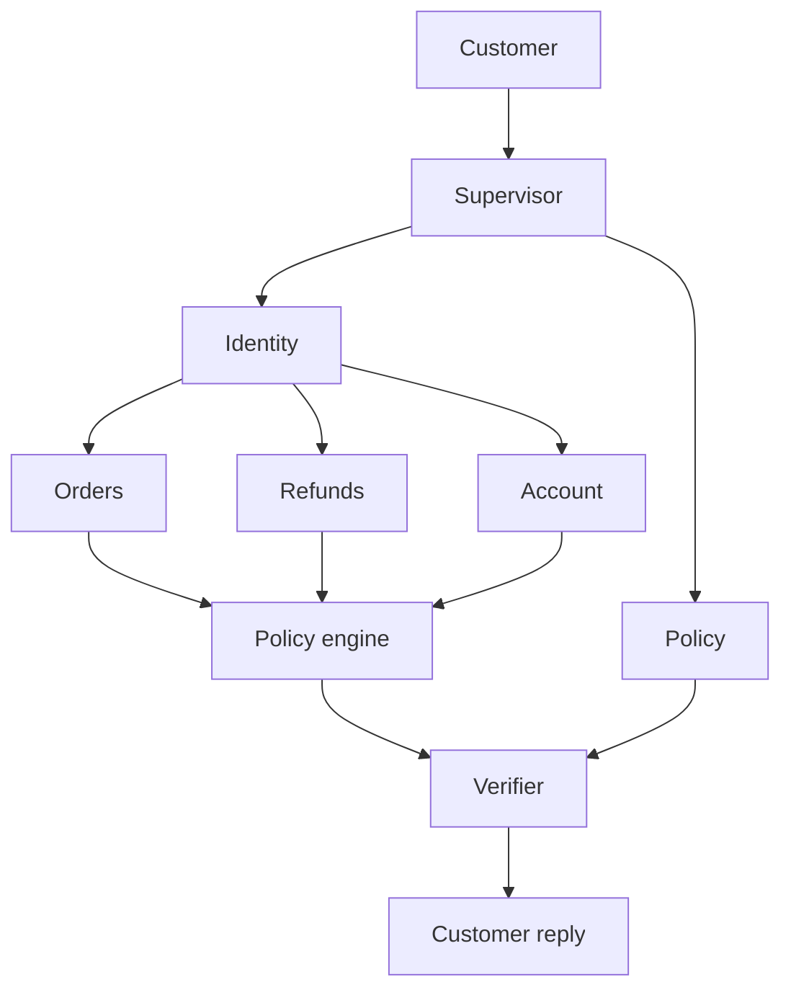

# AgentDesk slide source

This file is the only source for a hiring-manager deck. Copy the on-slide text. Do not add features, metrics, or claims that are not in this file.

**Repo:** https://github.com/bobpmprojects/agentdesk-ai  
**Audience:** a hiring manager for a product or applied-AI role  
**Length:** 12 slides. One idea per slide. Speaker notes stay off the slide.

Product: AgentDesk. Fictional store: Northwind Goods. All customers and orders are synthetic.

---

## Deck rules

- Use the slide titles and on-slide lines below word for word.
- Put speaker notes in the speaker-notes field, not on the slide.
- Use the two screenshots. Do not redraw the product UI.
- Recreate the agent diagram from the Mermaid in slide 6.
- Never say this is in production, handles real customers, or plans with a model.
- Never say the verifier checks every reply. It checks policy replies.
- The impressive claim is judgment under constraint: the agent can finish a request, refuse an illegal one, remember a follow-up, and prove it.

---

## Slide 1 — Title

**On slide**

AgentDesk

The AI decides what to do.  
Code decides whether it is allowed.  
A checker confirms it before the customer hears it.

**Speaker note**

I built a customer-service agent for a fictional store. The goal was not a better chatbot. The goal was to resolve the request inside store rules, with zero policy violations.

---

## Slide 2 — The request that can go wrong

**On slide**

> "My blender arrived broken. Refund it and send the replacement to my new address."

Four ways this fails:

- Refund the wrong person
- Refund $350 when the cap is $200
- Refund twice
- Promise a policy the store never wrote

**Speaker note**

This is one sentence and four product risks. An LLM is good at the sentence. It is a bad system of record for money, identity, and policy.

---

## Slide 3 — The product decision

**On slide**

Three jobs, three owners

| Job | Owner | Example |
|---|---|---|
| Decide what to do | Specialist agents | This is a refund |
| Decide if it is allowed | Python policy engine | $149 yes, $350 no |
| Decide what can be said | Verifier | No fake refund, no fake citation |

**Speaker note**

I separated "smart" from "allowed." The model writes the customer sentence. It does not approve a refund, a cancellation, or an address change.

---

## Slide 4 — What a customer can do today

**On slide**

Show this screenshot: `docs/snapshots/order-status-chat.png`

Caption: "Where is my order?" Replay mode. No API key.

**Speaker note**

Read the actual reply: order ORD-0002 shipped with Northwind Parcel, tracking ending in 0002, estimated delivery September 29, 2026. That sentence is built from the database, then phrased by the model. The same reply is committed in the repo, so the demo does not depend on a live model.

Other shipped behaviors, said out loud rather than listed if time is short:

- $149 damaged blender: refund processed.
- $350 blender: "We cannot automatically approve cash refunds for amounts above $200." Store credit is offered.
- Refund plus a new address on a delivered order: refund completes, address change is denied.
- "What is the cash refund limit?": cites `returns-and-refunds.md#refund-limit`.
- "Do you price match competitors?": "I couldn't find that answer in the Northwind Goods policy documents."
- "Replace it." Then "Actually, make it store credit.": no replacement is written; store credit is.

---

## Slide 5 — You can watch it run

**On slide**

Show this screenshot: `docs/snapshots/live-graph.png`

Caption: Active node `finalize`. Path for this request: supervisor, identity, orders, model reply, finalize.

**Speaker note**

This picture is exported from the running LangGraph, not drawn for the slide. The gold node is the step that just finished. Identity ran before any order data was read. The model ran only after the order facts existed.

GitHub copy of the same graph: https://github.com/bobpmprojects/agentdesk-ai/blob/main/docs/ARCHITECTURE.md

---

## Slide 6 — Five agents, not one

**On slide**



- Identity is the gate. No match, no data.
- Orders, Refunds, and Account each own one kind of change.
- Policy only answers from the written documents.
- Agents do not talk to each other. They hand a typed result back.

**Speaker note**

A single agent with every tool can refund while answering a policy question. Narrow agents make that mistake harder, and each one is testable on its own.

---

## Slide 7 — The moment it says no

**On slide**

$149 damaged blender

> "Your refund of $149 for the damaged blender has been processed."

$350 damaged blender

> "We cannot automatically approve cash refunds for amounts above $200. However, we can offer you store credit."

Same agent. Same tools. The difference is a Python rule.

**Speaker note**

The cap is $200, inclusive, inside 30 days of delivery. $200.01 is denied. Asking for the same refund twice still creates one refund, because the write has an idempotency key and an audit row.

Open this in the repo if asked: https://github.com/bobpmprojects/agentdesk-ai/blob/main/agentdesk/policy/engine.py

---

## Slide 8 — It remembers the case

**On slide**

Turn 1: "Please replace my damaged blender."

> "Replacement is eligible. No action has been taken yet."

Turn 2: "Actually, make it store credit."

> "The revised customer choice for order ID ORD-0008 is confirmed as store credit."

**Speaker note**

Memory is a small saved state: verified order, pending choice, prior actions. It does not store the raw email or street address. The follow-up reloads that state and checks policy again before writing. Nothing is written on turn 1.

---

## Slide 9 — Proof

**On slide**

| | |
|---|---|
| Automated tests | 27 / 27 |
| Full conversations replayed | 5 / 5 |
| Policy violations | 0 |
| Grounded actions | 100% |
| Valid citations | 100% |
| Unnecessary handoffs | 0 |
| CI | Passed, no API key |

**Speaker note**

CI runs lint, the 27 tests, and the 5 replayed conversations. The build fails if a policy violation appears. Passing run: https://github.com/bobpmprojects/agentdesk-ai/actions/runs/40976292028

The five conversations are order status, the $350 refusal, a refund that succeeds while an address change fails, a cited policy answer, and the store-credit follow-up.

---

## Slide 10 — Three tradeoffs

**On slide**

1. **Code approves money.** A $200 rule can be tested. A model's judgment cannot.
2. **Keywords route the demo.** Replay stays stable. Open-ended phrasing is the known limit.
3. **Five golden conversations, not a large benchmark.** One illegal refund fails the build. I am not claiming it handles every messy ticket.

**Speaker note**

I also chose keyword search over a vector database because the policy set is six documents and a citation has to be exact. I chose a local SQLite store over Stripe because the product question was authorization and audit, not payment networks. Refunds and shipping labels in this demo are mock records with real audit rows.

---

## Slide 11 — What I would not claim

**On slide**

Working, and tested:

- Identity before any order read or refund
- $200 / 30-day refund rule, including the refusal
- One refund when the request is repeated
- Partial success when one part of a request is illegal
- Cited answers, and an honest "not in the policy"
- A follow-up that changes replacement to store credit

Not this version:

- Open-ended wording. Routing is keyword-based.
- The verifier on every reply. It is fully wired for policy replies.
- Real payments, carriers, or a human queue.
- A broad language benchmark. The bar is 5 conversations.

**Speaker note**

Say the gaps before you are asked. The tests for the scoped behavior pass. The gaps are scope, not hidden failures. The first upgrade I would make is model-based planning in the Supervisor, still behind the same policy engine.

---

## Slide 12 — Close

**On slide**

The impressive part is not that it talks.

It can refuse, remember, and prove what it did.

https://github.com/bobpmprojects/agentdesk-ai

**Speaker note**

If there is a laptop: run replay mode, send "Where is my order?" for ORD-0002, and show the gold node land on finalize. Then open the policy engine and the passing GitHub Action. Ninety seconds.

```bash
MODEL_PROVIDER=openai LLM_MODE=replay uv run streamlit run agentdesk/ui/app.py
```

---

## Screenshot files

Put these on slides 4 and 5. They were captured from the running Streamlit app in replay mode.

- `docs/snapshots/order-status-chat.png` — customer question and grounded reply
- `docs/snapshots/live-graph.png` — compiled graph, active node `finalize`, mode REPLAY

GitHub links after this file is pushed:

- https://github.com/bobpmprojects/agentdesk-ai/blob/main/docs/snapshots/order-status-chat.png
- https://github.com/bobpmprojects/agentdesk-ai/blob/main/docs/snapshots/live-graph.png

---

## Appendix A — exact replies

Use these if a slide needs a quote. Do not paraphrase them into a stronger claim.

**Order status, ORD-0002**

> Your order (ORD-0002) has been shipped via Northwind Parcel and is on its way. The tracking number ending in ••••0002 can be used to monitor its progress. The estimated delivery date is September 29, 2026.

**$149 refund, ORD-0008**

> Your refund of $149 for the damaged blender has been processed, as your request meets our policy requirements. You should see the amount credited back to your original payment method shortly.

**$350 refund, ORD-0004**

> We cannot automatically approve cash refunds for amounts above $200. However, we can offer you store credit for the value of the damaged blender.

**Refund plus address change, delivered order**

> Completed Steps: Refund: Approved for $149 because it is within $200 and 30 days of delivery.
> Denied Steps: Change Original Order Address: Denied because the order has already shipped.

**Policy, covered**

> Verified refunds of $200 or less may be automatically approved. For amounts above $200, offer store credit instead of a cash refund. [returns-and-refunds.md#refund-limit]

**Policy, not covered**

> I couldn't find that answer in the Northwind Goods policy documents, so I can't make a policy claim about it.

**Follow-up**

> FIRST TURN: Replacement is eligible. No action has been taken yet; you can confirm or change the resolution.
> FOLLOW-UP: The revised customer choice for order ID ORD-0008 is confirmed as "store credit."

---

## Appendix B — evidence links

Do not make a slide out of this list. Use it when someone asks "show me."

| Proof | Link |
|---|---|
| Repo | https://github.com/bobpmprojects/agentdesk-ai |
| Passing CI | https://github.com/bobpmprojects/agentdesk-ai/actions/runs/40976292028 |
| Compiled graph | https://github.com/bobpmprojects/agentdesk-ai/blob/main/docs/ARCHITECTURE.md |
| Policy engine | https://github.com/bobpmprojects/agentdesk-ai/blob/main/agentdesk/policy/engine.py |
| Refund policy text | https://github.com/bobpmprojects/agentdesk-ai/blob/main/policies/returns-and-refunds.md |
| Duplicate-refund tests | https://github.com/bobpmprojects/agentdesk-ai/blob/main/tests/integration/test_m2_guarded_writes.py |
| Citation tests | https://github.com/bobpmprojects/agentdesk-ai/blob/main/tests/integration/test_m4_policy_verifier.py |
| Five eval cases | https://github.com/bobpmprojects/agentdesk-ai/blob/main/fixtures/eval_cases/core.json |
| Saved model replies | https://github.com/bobpmprojects/agentdesk-ai/tree/main/fixtures/replay |
| CI definition | https://github.com/bobpmprojects/agentdesk-ai/blob/main/.github/workflows/ci.yml |

Eval scores from the local replay run: 5 cases, task resolution 1.0, policy violations 0, grounded action claims 1.0, citation validity 1.0, unnecessary escalations 0, replay deterministic.

---

## Appendix C — rules and stack

Store rules in the policy engine:

- Refunds up to $200 within 30 days of delivery are approved.
- Larger cash refunds are denied and store credit is offered.
- Cancellation only while the order is processing.
- One address change per order, before shipment, unless it is a replacement destination.
- Identity is required before a protected read or write.

Stack, one line if needed: Python 3.11, LangGraph, LangChain for OpenAI / Anthropic / Bedrock, Pydantic, SQLite, BM25 over six Markdown policy docs, Streamlit, pytest, GitHub Actions.

Seed data: 50 customers, 150 orders. Default demo: order `ORD-0002`, email `customer001@northwind.test`.

---

## Appendix D — do not get this wrong

- Current orchestration is LangGraph. Do not describe an older framework as the current stack.
- Routing in this version is keyword-based for the demo scenarios.
- The verifier is complete on policy replies, not on every older action reply.
- Labels, replacements, and payments are local mock records.
- `.env` and API keys are not in the repo.
- CI run `40976292028` passed on commit `09c5562`. Later doc commits do not change that code result.
