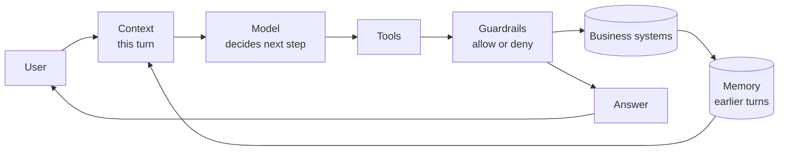

# Agent notes

A standard agent is a loop: read the current situation, decide the next step, use a tool if needed, and answer. Three pieces keep that loop reliable.

## Context

Context is what the agent can see **right now**.

In AgentDesk, one turn carries `AgentContext`:

- conversation ID
- turn ID
- the customer message
- verified identity, once identity succeeds
- the active order ID

The model does not receive the whole database. The Supervisor selects only the facts needed for the current prompt: order status, policy text, or the result of a write.

## Memory

Memory is what survives **after this turn ends**.

AgentDesk stores a small typed `ConversationState` in SQLite:

- verified customer and active order
- pending and completed intents
- offered alternatives
- prior audited actions
- idempotency keys

This lets a later message such as “actually, make it store credit” continue the same case. Raw email and street address stay out of that stored state.

Other stored records have different jobs:

- `audit_log` records what actually changed
- replay fixtures remember model responses for demos
- traces show the run in the UI

## Guardrails

Guardrails decide what the agent is **allowed** to do.

The model may request an action. Python decides whether it happens:

1. Identity must match before protected reads or writes.
2. The Policy Engine checks refund caps, return windows, shipment state, and address-change limits.
3. Every write uses an idempotency key and an audit record in one database transaction.
4. The Verifier checks claimed actions and policy citations before a policy reply is sent.
5. A failed reply may be regenerated once. A second failure becomes a safe fallback.

## Standard agent

Read it left to right: memory fills the current context, the model chooses a step, guardrails approve any real action, and the result is saved for the next turn.

## AgentDesk components

| Component | Job |
|---|---|
| Streamlit | Chat, live graph, and redacted trace |
| Supervisor | LangGraph node that chooses the next specialist |
| Identity | Checks order ID plus email |
| Orders | Reads status and tracking; cancels only before shipment |
| Returns & Refunds | Assesses damage and issues refunds, credit, labels, or replacements |
| Account | Changes a shipping address or contact preferences |
| Policy/Knowledge | Answers from six Markdown policy docs with section citations |
| Memory | Loads and saves conversation state |
| Verifier | Checks actions, citations, tone, and unsupported promises |
| Model reply | Writes the customer-facing sentence from verified facts |
| Policy Engine | Deterministic allow/deny rules |
| Tools | Typed database operations |
| SQLite | Customers, orders, shipments, refunds, addresses, audit log, and memory |
| LangChain adapter | Live OpenAI, Anthropic, or Bedrock call |
| Record/Replay | Serves a saved model response when no live call is needed |

Specialists return typed results to the Supervisor. They do not chat with one another.
