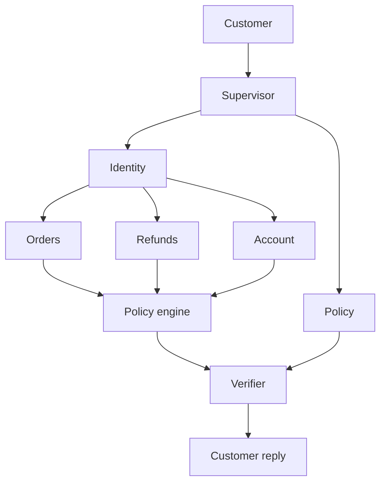
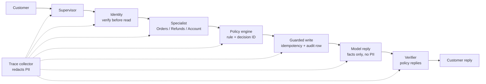

# AgentDesk slide source

This file is the only source for a hiring-manager deck. Copy the on-slide text. Do not add features, metrics, or claims that are not in this file.

**Repo:** https://github.com/bobpmprojects/agentdesk-ai  
**Audience:** a hiring manager for a product or applied-AI role  
**Length:** 12 slides, plus one backup slide (B1) shown only if asked. One idea per slide. Speaker notes stay off the slide.

Product: AgentDesk. Fictional store: Northwind Goods. All customers and orders are synthetic.

---

## Deck rules

- Use the slide titles and on-slide lines below word for word.
- Put speaker notes in the speaker-notes field, not on the slide.
- Use the two screenshots. Do not redraw the product UI.
- Recreate the agent diagram from the Mermaid in slide 6.
- Never say this is in production, handles real customers, or plans with a model.
- Never say the verifier checks every reply. It checks policy replies.
- The impressive claim is judgment under constraint: the agent can finish a request, refuse an illegal one, remember a follow-up, and prove it.
- Never say AgentDesk is GDPR, CCPA, SOC 2, or HIPAA compliant, or that it enforces data residency. Appendix F separates what is built from what is designed.

---

## Slide 1 — Title

**On slide**

AgentDesk

The AI decides what to do.  
Code decides whether it is allowed.  
A checker confirms it before the customer hears it.

**Speaker note**

I built a customer-service agent for a fictional store. The goal was not a better chatbot. The goal was to resolve the request inside store rules, with zero policy violations.

---

## Slide 2 — The request that can go wrong

**On slide**

> "My blender arrived broken. Refund it and send the replacement to my new address."

Four ways this fails:

- Refund the wrong person
- Refund $350 when the cap is $200
- Refund twice
- Promise a policy the store never wrote

**Speaker note**

This is one sentence and four product risks. An LLM is good at the sentence. It is a bad system of record for money, identity, and policy.

---

## Slide 3 — The product decision

**On slide**

Three jobs, three owners

| Job | Owner | Example |
|---|---|---|
| Decide what to do | Specialist agents | This is a refund |
| Decide if it is allowed | Python policy engine | $149 yes, $350 no |
| Decide what can be said | Verifier | No fake refund, no fake citation |

**Speaker note**

I separated "smart" from "allowed." The model writes the customer sentence. It does not approve a refund, a cancellation, or an address change.

---

## Slide 4 — What a customer can do today

**On slide**

Show this screenshot: `docs/snapshots/order-status-chat.png`

Caption: "Where is my order?" Replay mode. No API key.

**Speaker note**

Read the actual reply: order ORD-0002 shipped with Northwind Parcel, tracking ending in 0002, estimated delivery September 29, 2026. That sentence is built from the database, then phrased by the model. The same reply is committed in the repo, so the demo does not depend on a live model.

Other shipped behaviors, said out loud rather than listed if time is short:

- $149 damaged blender: refund processed.
- $350 blender: "We cannot automatically approve cash refunds for amounts above $200." Store credit is offered.
- Refund plus a new address on a delivered order: refund completes, address change is denied.
- "What is the cash refund limit?": cites `returns-and-refunds.md#refund-limit`.
- "Do you price match competitors?": "I couldn't find that answer in the Northwind Goods policy documents."
- "Replace it." Then "Actually, make it store credit.": no replacement is written; store credit is.

---

## Slide 5 — You can watch it run

**On slide**

Show this screenshot: `docs/snapshots/live-graph.png`

Caption: Active node `finalize`. Path for this request: supervisor, identity, orders, model reply, finalize.

**Speaker note**

This picture is exported from the running LangGraph, not drawn for the slide. The gold node is the step that just finished. Identity ran before any order data was read. The model ran only after the order facts existed.

GitHub copy of the same graph: https://github.com/bobpmprojects/agentdesk-ai/blob/main/docs/ARCHITECTURE.md

---

## Slide 6 — Five agents, not one

**On slide**



- Identity is the gate. No match, no data.
- Orders, Refunds, and Account each own one kind of change.
- Policy only answers from the written documents.
- Agents do not talk to each other. They hand a typed result back.

**Speaker note**

A single agent with every tool can refund while answering a policy question. Narrow agents make that mistake harder, and each one is testable on its own.

---

## Slide 7 — The moment it says no

**On slide**

$149 damaged blender

> "Your refund of $149 for the damaged blender has been processed."

$350 damaged blender

> "We cannot automatically approve cash refunds for amounts above $200. However, we can offer you store credit."

Same agent. Same tools. The difference is a Python rule.

**Speaker note**

The cap is $200, inclusive, inside 30 days of delivery. $200.01 is denied. Asking for the same refund twice still creates one refund, because the write has an idempotency key and an audit row.

Open this in the repo if asked: https://github.com/bobpmprojects/agentdesk-ai/blob/main/agentdesk/policy/engine.py

---

## Slide 8 — It remembers the case

**On slide**

Turn 1: "Please replace my damaged blender."

> "Replacement is eligible. No action has been taken yet."

Turn 2: "Actually, make it store credit."

> "The revised customer choice for order ID ORD-0008 is confirmed as store credit."

**Speaker note**

Memory is a small saved state: verified order, pending choice, prior actions. It does not store the raw email or street address. The follow-up reloads that state and checks policy again before writing. Nothing is written on turn 1.

---

## Slide 9 — Proof

**On slide**

| | |
|---|---|
| Automated tests | 27 / 27 |
| Full conversations replayed | 5 / 5 |
| Policy violations | 0 |
| Grounded actions | 100% |
| Valid citations | 100% |
| Unnecessary handoffs | 0 |
| CI | Passed, no API key |

**Speaker note**

CI runs lint, the 27 tests, and the 5 replayed conversations. The build fails if a policy violation appears. Passing run: https://github.com/bobpmprojects/agentdesk-ai/actions/runs/40976292028

The five conversations are order status, the $350 refusal, a refund that succeeds while an address change fails, a cited policy answer, and the store-credit follow-up. The full 27-test list is in Appendix E. Do not put that list on this slide.

---

## Slide 10 — Three tradeoffs

**On slide**

1. **Code approves money.** A $200 rule can be tested. A model's judgment cannot.
2. **Keywords route the demo.** Replay stays stable. Open-ended phrasing is the known limit.
3. **Five golden conversations, not a large benchmark.** One illegal refund fails the build. I am not claiming it handles every messy ticket.

**Speaker note**

I also chose keyword search over a vector database because the policy set is six documents and a citation has to be exact. I chose a local SQLite store over Stripe because the product question was authorization and audit, not payment networks. Refunds and shipping labels in this demo are mock records with real audit rows.

---

## Slide 11 — What I would not claim

**On slide**

Working, and tested:

- Identity before any order read or refund
- $200 / 30-day refund rule, including the refusal
- One refund when the request is repeated
- Partial success when one part of a request is illegal
- Cited answers, and an honest "not in the policy"
- A follow-up that changes replacement to store credit

Not this version:

- Open-ended wording. Routing is keyword-based.
- The verifier on every reply. It is fully wired for policy replies.
- Real payments, carriers, or a human queue.
- A broad language benchmark. The bar is 5 conversations.

**Speaker note**

Say the gaps before you are asked. The tests for the scoped behavior pass. The gaps are scope, not hidden failures. The first upgrade I would make is model-based planning in the Supervisor, still behind the same policy engine.

---

## Slide 12 — Close

**On slide**

The impressive part is not that it talks.

It can refuse, remember, and prove what it did.

https://github.com/bobpmprojects/agentdesk-ai

**Speaker note**

If there is a laptop: run replay mode, send "Where is my order?" for ORD-0002, and show the gold node land on finalize. Then open the policy engine and the passing GitHub Action. Ninety seconds.

```bash
MODEL_PROVIDER=openai LLM_MODE=replay uv run streamlit run agentdesk/ui/app.py
```

---

## Backup slide B1 — Trust is a node, not a promise

Show only if the hiring manager asks about privacy, security, or compliance. Source: Appendix F.

**On slide**

| Control | Built today | Where |
|---|---|---|
| Identity | Order ID + email must match before any read or write | Identity agent |
| Privacy | Email is a secret type. Traces redact PII. The model never sees an email or street address. | Tools, tracing, model reply |
| Governance | Rules are versioned code. Every write has an audit row and a policy decision ID. | Policy engine, audit log |
| Compliance | CI fails on one policy violation | GitHub Actions |
| Data residency | Designed, not built | Next version |

**Speaker note**

Each control lives in one node, so I can test it and point to it. The model writes sentences; it never holds customer PII and never approves an action. I would not call this compliant with any regulation. What I can show is the evidence a compliance review asks for: who was verified, which rule decided, what was written, and a build that fails when a rule is broken. Residency is the honest gap; Appendix F has the design.

---

## Screenshot files

Put these on slides 4 and 5. They were captured from the running Streamlit app in replay mode.

- `docs/snapshots/order-status-chat.png` — customer question and grounded reply
- `docs/snapshots/live-graph.png` — compiled graph, active node `finalize`, mode REPLAY

GitHub links after this file is pushed:

- https://github.com/bobpmprojects/agentdesk-ai/blob/main/docs/snapshots/order-status-chat.png
- https://github.com/bobpmprojects/agentdesk-ai/blob/main/docs/snapshots/live-graph.png

---

## Appendix A — exact replies

Use these if a slide needs a quote. Do not paraphrase them into a stronger claim.

**Order status, ORD-0002**

> Your order (ORD-0002) has been shipped via Northwind Parcel and is on its way. The tracking number ending in ••••0002 can be used to monitor its progress. The estimated delivery date is September 29, 2026.

**$149 refund, ORD-0008**

> Your refund of $149 for the damaged blender has been processed, as your request meets our policy requirements. You should see the amount credited back to your original payment method shortly.

**$350 refund, ORD-0004**

> We cannot automatically approve cash refunds for amounts above $200. However, we can offer you store credit for the value of the damaged blender.

**Refund plus address change, delivered order**

> Completed Steps: Refund: Approved for $149 because it is within $200 and 30 days of delivery.
> Denied Steps: Change Original Order Address: Denied because the order has already shipped.

**Policy, covered**

> Verified refunds of $200 or less may be automatically approved. For amounts above $200, offer store credit instead of a cash refund. [returns-and-refunds.md#refund-limit]

**Policy, not covered**

> I couldn't find that answer in the Northwind Goods policy documents, so I can't make a policy claim about it.

**Follow-up**

> FIRST TURN: Replacement is eligible. No action has been taken yet; you can confirm or change the resolution.
> FOLLOW-UP: The revised customer choice for order ID ORD-0008 is confirmed as "store credit."

---

## Appendix B — evidence links

Do not make a slide out of this list. Use it when someone asks "show me."

| Proof | Link |
|---|---|
| Repo | https://github.com/bobpmprojects/agentdesk-ai |
| Passing CI | https://github.com/bobpmprojects/agentdesk-ai/actions/runs/40976292028 |
| Compiled graph | https://github.com/bobpmprojects/agentdesk-ai/blob/main/docs/ARCHITECTURE.md |
| Policy engine | https://github.com/bobpmprojects/agentdesk-ai/blob/main/agentdesk/policy/engine.py |
| Refund policy text | https://github.com/bobpmprojects/agentdesk-ai/blob/main/policies/returns-and-refunds.md |
| Duplicate-refund tests | https://github.com/bobpmprojects/agentdesk-ai/blob/main/tests/integration/test_m2_guarded_writes.py |
| Citation tests | https://github.com/bobpmprojects/agentdesk-ai/blob/main/tests/integration/test_m4_policy_verifier.py |
| Five eval cases | https://github.com/bobpmprojects/agentdesk-ai/blob/main/fixtures/eval_cases/core.json |
| Saved model replies | https://github.com/bobpmprojects/agentdesk-ai/tree/main/fixtures/replay |
| CI definition | https://github.com/bobpmprojects/agentdesk-ai/blob/main/.github/workflows/ci.yml |

Eval scores from the local replay run: 5 cases, task resolution 1.0, policy violations 0, grounded action claims 1.0, citation validity 1.0, unnecessary escalations 0, replay deterministic.

---

## Appendix C — rules and stack

Store rules in the policy engine:

- Refunds up to $200 within 30 days of delivery are approved.
- Larger cash refunds are denied and store credit is offered.
- Cancellation only while the order is processing.
- One address change per order, before shipment, unless it is a replacement destination.
- Identity is required before a protected read or write.

Stack, one line if needed: Python 3.11, LangGraph, LangChain for OpenAI / Anthropic / Bedrock, Pydantic, SQLite, BM25 over six Markdown policy docs, Streamlit, pytest, GitHub Actions.

Seed data: 50 customers, 150 orders. Default demo: order `ORD-0002`, email `customer001@northwind.test`.

---

## Appendix D — do not get this wrong

- Current orchestration is LangGraph. Do not describe an older framework as the current stack.
- Routing in this version is keyword-based for the demo scenarios.
- The verifier is complete on policy replies, not on every older action reply.
- Labels, replacements, and payments are local mock records.
- `.env` and API keys are not in the repo.
- CI run `40976292028` passed on commit `09c5562`. Later doc commits do not change that code result.
- No compliance certification or legal review exists. Data residency, consent, retention, deletion requests, and role-based access are designs, not code. See Appendix F.

---

## Appendix E — tests that passed

Do not put all 27 names on one slide. Slide 9 keeps the scorecard. Use this list when someone asks what was actually tested.

Local commands, no API key:

```bash
uv run pytest
MODEL_PROVIDER=openai LLM_MODE=replay uv run python -m agentdesk.evals
```

Result: **27 / 27** pytest tests passed. The replay evaluation passed **5 / 5** conversations, with **0** policy violations, **100%** grounded actions, **100%** valid citations, and **0** unnecessary handoffs.

### Foundation — `tests/unit/test_m0_foundation.py`

- The seed data has 50 customers and 150 orders in mixed states.
- Six policy documents have stable section IDs.
- A recorded model call replays the exact same response.
- Replay never falls through to a live model when a fixture is missing.
- Switching the provider selects the configured model.
- Traces redact personal information.

### Order status — `tests/integration/test_m1_order_status.py`

- A wrong email stops the flow before any order lookup.
- A verified shipped order returns the database status and a redacted trace.

### Policy rules — `tests/unit/test_m2_policy_engine.py`

- A $200 refund is allowed.
- A refund above $200 is denied and store credit is offered.
- Identity is required before any other rule runs.

### Guarded writes — `tests/integration/test_m2_guarded_writes.py`

- The same refund twice does not create a second refund.
- Nothing is written without identity verification.
- An over-cap refund is denied and store credit is offered.
- Cancellation is allowed only before shipment.

### Multi-intent — `tests/integration/test_m3_multi_intent.py`

- A replacement changes the address first, and a second address change is denied.
- A refund still completes when the address change on a delivered order is denied.
- A verified customer can update contact preferences.

### Policy and verifier — `tests/integration/test_m4_policy_verifier.py`

- A covered question returns a real section citation. An uncovered one says it is not in the policy.
- A fabricated refund and a fabricated citation are blocked before the model runs.
- The supervisor verifies both a grounded answer and an uncovered answer.
- A failed tone check is regenerated once, then replaced with the safe fallback.

### Memory — `tests/integration/test_m5_conversation_state.py`

- "Actually, make it store credit" reloads the case, writes no replacement, and records only store credit.

### Graph — `tests/unit/test_langgraph_architecture.py`

- The compiled graph contains every agent node.
- Order status runs through supervisor, identity, orders, model reply, and finalize.
- Shared graph state is a Pydantic model.

### Eval gate — `tests/evals/test_replay_evals.py`

- The replay suite reports zero policy violations.

### Five replayed conversations — `fixtures/eval_cases/core.json`

| ID | What it checks |
|---|---|
| `m1-order-status` | Verified order lookup returns `ORD-0002` |
| `m2-refund-boundaries` | The $350 cash refund is refused and store credit is offered |
| `m3-multi-intent` | The refund succeeds and the address change is denied |
| `m4-policy-grounding` | The refund-limit answer cites `returns-and-refunds.md#refund-limit` |
| `m5-follow-up` | A later message changes the resolution to store credit |

---

## Appendix F — identity, privacy, residency, governance, compliance

Use this when someone asks "how would this pass a security or compliance review?" Every row says whether it is **built** (in code, with a test or file to show) or **designed** (the next step, not in this version). Do not move a designed row into a built claim.

### The principle

Trust controls are placed in nodes, not in the prompt. A prompt can be argued with. A node either runs or the request stops.



### 1. Identity — built

| What | Evidence |
|---|---|
| Order ID + email must match before any customer, order, shipment, refund, or address data is read or changed | `agentdesk/agents/identity.py`, `db/repository.py` `verify_identity`, policy `identity-and-privacy.md#order-verification` |
| A wrong email stops the flow before any order lookup | `tests/integration/test_m1_order_status.py` |
| Nothing is written without verification | `tests/integration/test_m2_guarded_writes.py` |
| Identity is the first rule the policy engine checks | `tests/unit/test_m2_policy_engine.py` |
| After verification, agents pass a `VerifiedIdentity` (customer ID, order ID, verification ID, time), not the email | `schemas/tools.py` |

Designed, not built: step-up verification (one-time code) before money moves above a threshold; rate-limiting failed matches to stop order-ID guessing; staff identity and roles for a human-agent console.

### 2. Privacy — built

| What | Evidence |
|---|---|
| Email is a Pydantic `SecretStr` in every agent and tool schema, so it does not print in logs or reprs | `schemas/agents.py`, `schemas/tools.py` |
| Traces redact email, street lines, postal code, tracking number, and API keys | `runtime/tracing.py`; test "Traces redact personal information" in `test_m0_foundation.py` |
| Tracking numbers are masked to the last four digits before they reach the reply | `db/repository.py` (`••••0002`) |
| The model receives only the decided facts. The committed model prompts contain no email or street address | `fixtures/replay/` |
| Conversation memory keeps verified IDs, intents, and prior actions, not the raw email or street address | `runtime/conversation.py`, `ConversationState` |
| No API keys in the repo; keys are `SecretStr` settings from `.env` | `config.py`, `.gitignore` |

Designed, not built: retention window and automatic purge of `conversation_state`; a customer data-export and delete request flow; consent and purpose records; PII detection on free text the customer types (today redaction is by field name, not content).

### 3. Data residency — designed, not built

Today everything runs locally: SQLite on the machine, and in RECORD mode one model provider chosen by `MODEL_PROVIDER`. There is no region pin.

The design, if a customer said "EU data stays in the EU":

1. A `region` field on the tenant and conversation, set at intake.
2. The Supervisor picks the database and model endpoint for that region. The specialists do not change.
3. The policy engine adds one rule: refuse a call whose endpoint region does not match the data region.
4. The audit row records the region used, so residency is provable after the fact.

Why it fits this architecture: model choice is already behind one adapter (`agents/langchain_adapter.py`), and every write already goes through one engine and one audit table. Residency is a routing rule plus one more check, not a rewrite.

### 4. Governance — built

| What | Evidence |
|---|---|
| Business rules are plain Python, versioned in git and reviewed like code. The model cannot change them | `agentdesk/policy/engine.py` |
| Every decision returns a rule ID, reason, and deterministic decision ID (same input, same ID) | `PolicyDecision` in `schemas/common.py` |
| Every write has an idempotency key and an `audit_log` row: operation, outcome (`committed`, `denied`, `duplicate`, `failed`), policy decision ID, time | `db/schema.sql` |
| Policy answers must cite a real section, or say the answer is not in the policy | `tests/integration/test_m4_policy_verifier.py` |
| Agents have narrow tools. A policy question cannot trigger a refund | Slide 6, `agents/` |
| Model replies are recorded and committed, so behavior can be reviewed and replayed | `fixtures/replay/` |

Designed, not built: a policy version stamped on each audit row; approval workflow for rule changes; a human review queue for denied or ambiguous cases; a model and prompt inventory per release.

### 5. Compliance — partial

Built: the evidence a review asks for. Who was verified, which rule decided, what was written, what the model was shown, and a CI build that fails on one policy violation (`.github/workflows/ci.yml`, `tests/evals/test_replay_evals.py`).

Not built, and not claimed: any certification or legal review (GDPR, CCPA, SOC 2, PCI). Payments are mock records, so PCI scope is not exercised.

The line to say: "I built the controls and the audit trail that make a compliance review possible. I would not call a demo compliant."

### Per-node summary

| Node | Identity | Privacy | Residency | Governance | Compliance evidence |
|---|---|---|---|---|---|
| Supervisor | Routes to Identity first | Sees request text only | Designed: picks regional endpoint | Keyword routing, no free-form chatter | Trace |
| Identity | Order ID + email match | Email as `SecretStr` | Designed | Policy-gated | Test |
| Orders / Refunds / Account | Require `VerifiedIdentity` | Masked tracking | Designed | One kind of change each | Audit row |
| Policy engine | Rule 1 is identity | No PII in decision | Designed: region-match rule | Rule ID + decision ID | Unit tests |
| Model reply | Never sees email | Facts only | Designed: regional model | Cannot approve actions | Replay fixtures |
| Verifier | — | Blocks fabricated claims | — | Citation must exist | Test |
| Trace collector | — | Redacts by field | — | Every step logged | CI |

### Top three upgrades to make this real, ranked

1. **Retention and delete-request flow.** Smallest code change, and the first question a privacy reviewer asks.
2. **Region field plus region-match policy rule.** Turns residency from a design into a test.
3. **Policy version on every audit row.** Makes "which rule was in force on that day" answerable.
